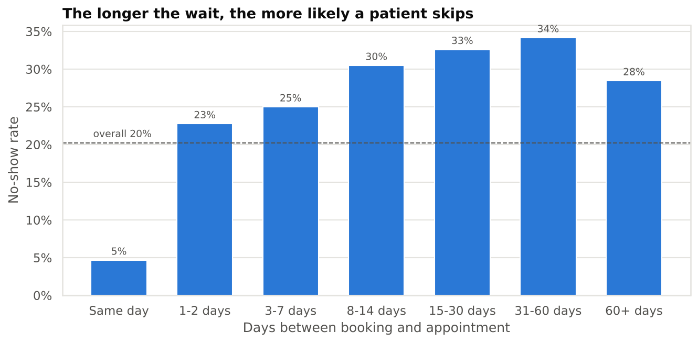
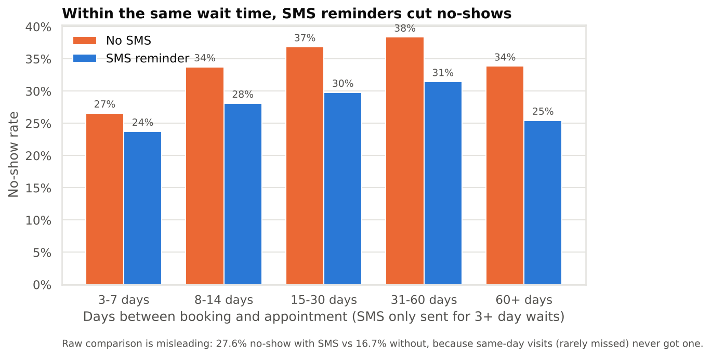
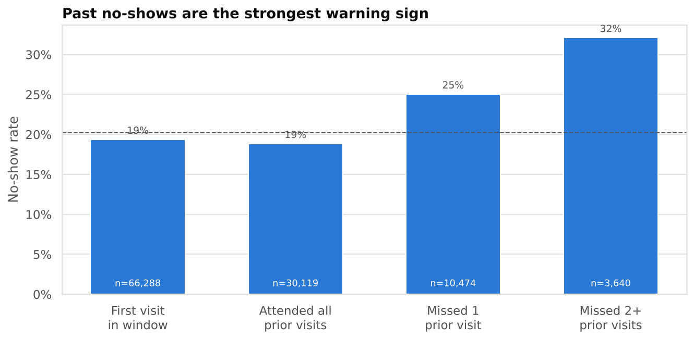
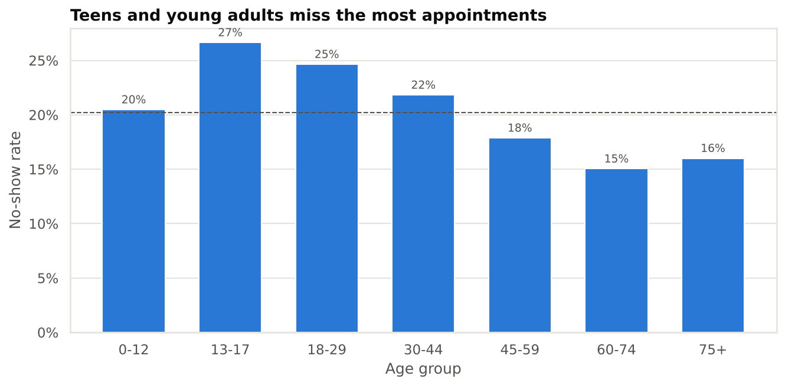
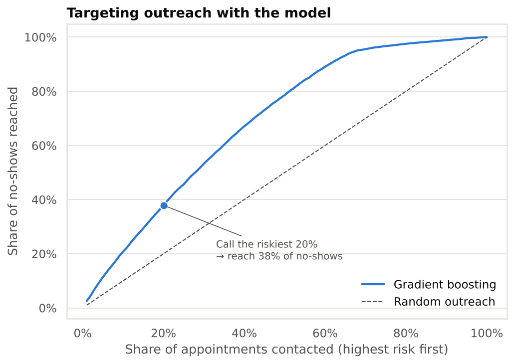
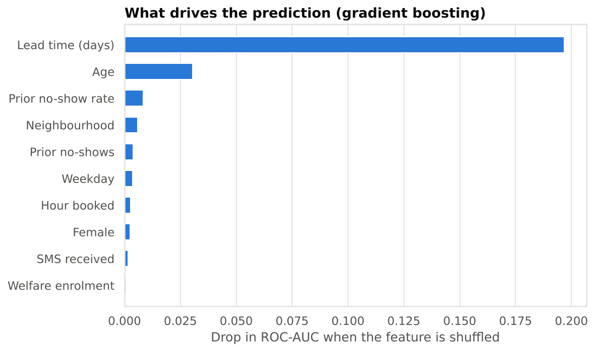

# Medical Appointment No-Shows: Analysis & Prediction

**Why do 1 in 5 patients miss their medical appointments, and can we predict who will?**

An end-to-end healthcare analytics project on **110,521 appointments** from public clinics in Vitória, Brazil (Apr–Jun 2016). It covers data cleaning, SQL analysis, a causal-inference pitfall (Simpson's paradox), statistical modelling and a machine-learning risk score evaluated the way it would be used in practice.

**Stack:** Python · pandas · SQL (SQLite) · scikit-learn · statsmodels · Matplotlib / Seaborn · Jupyter

---

## Key findings

| # | Finding | Evidence |
|---|---|---|
| 1 | **Wait time is the #1 driver.** Same-day visits are missed under 5% of the time; waits of 2+ weeks are missed ~1 in 3 times. |  |
| 2 | **SMS reminders *look* harmful but actually help.** Raw data: 27.6% no-show with SMS vs 16.7% without. That's Simpson's paradox: SMS was only sent for 3+ day waits. Within each lead-time group, reminders cut no-shows by 3–8 points; logistic regression gives **odds ratio 0.76 (95% CI 0.74–0.79)**. |  |
| 3 | **Past no-shows predict future ones.** 2+ earlier misses → 32% no-show rate vs 19% for patients who always attended. |  |
| 4 | **Teens & young adults miss most** (27% at 13–17), seniors least (15%). Welfare (Bolsa Família) recipients miss more (24% vs 20%), which suggests access barriers. |  |

## Predictive model

**Use case:** the day before, rank tomorrow's appointments by no-show risk so staff can call or overbook the riskiest ones.

- **Time-based validation:** train on appointments before 25 May 2016, test on the following two weeks, so the model is scored only on future dates.
- **No leakage:** patient-history features only count appointments on *earlier* dates.

| Model | ROC-AUC | PR-AUC | No-shows reached by calling top 20% |
|---|---|---|---|
| Baseline (rank by lead time) | 0.692 | 0.281 | 31.9% |
| Logistic regression | 0.728 | 0.343 | 37.4% |
| **Gradient boosting** | **0.735** | **0.342** | **37.9%** |

Calling the riskiest 20% of patients reaches **~38% of all no-shows**, nearly 2× random outreach.

<p float="left">
  
  
</p>

## Recommendations to lower the missed appointments  

1. **Shorten booking queues / protect short-notice slots.** Lead time is the biggest risk factor for no shows.
2. **Send SMS reminders for every appointment booked 1+ days ahead.** 1–2 day bookings currently get none.
3. **Use the risk score** to target reminder calls or overbooking on the top 20–30% riskiest slots.
4. **Reduce access barriers** for young adults and welfare recipients. Having more flexible hours or transport will also help.

## Project structure

```
├── data/raw/appointments.csv        # original Kaggle data
├── src/
│   ├── clean.py                     # cleaning + feature engineering -> CSV + SQLite
│   ├── run_sql.py                   # runs sql/analysis.sql -> reports/sql_results.md
│   ├── eda.py                       # exploratory charts
│   ├── model.py                     # logistic regression + gradient boosting, evaluation
│   └── export_dashboard_data.py     # small aggregate CSVs for the interactive dashboard
├── sql/analysis.sql                 # 10 queries: aggregations, CTEs, window functions
├── notebooks/no_show_analysis.ipynb # narrative walkthrough of the results
├── reports/
│   ├── figures/                     # all charts
│   ├── sql_results.md               # query outputs
│   ├── metrics.json                 # model scores + feature importance
│   └── dashboard_data/              # aggregates behind the interactive dashboard
└── run_all.py                       # reproduce everything
```


## Limitations

- Six weeks of data from one Brazilian city (2016), so results may not generalise.
- Patient history only covers this window, so some "first visits" aren't really first visits.
- The SMS effect is an adjusted observational association, not a randomised result.
- The data has no visit reason, specialty, distance or weather; those would likely improve the model.

## Data

[Medical Appointment No Shows](https://www.kaggle.com/datasets/joniarroba/noshowappointments) on Kaggle (JoniHoppen). See the Kaggle page for licence terms.
